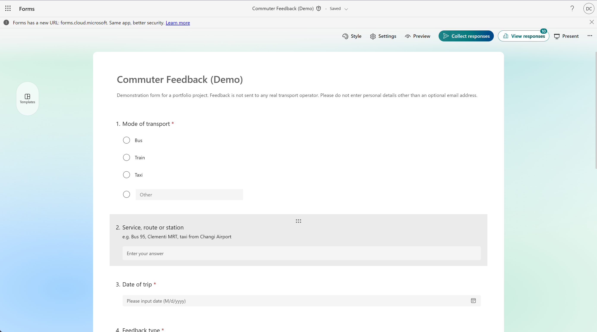
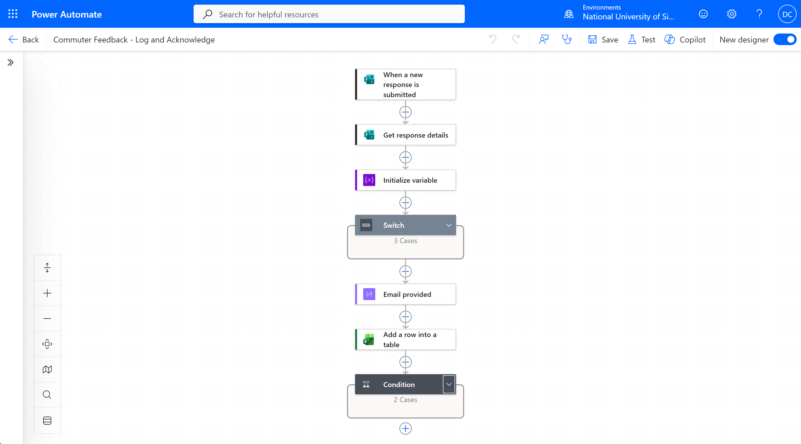
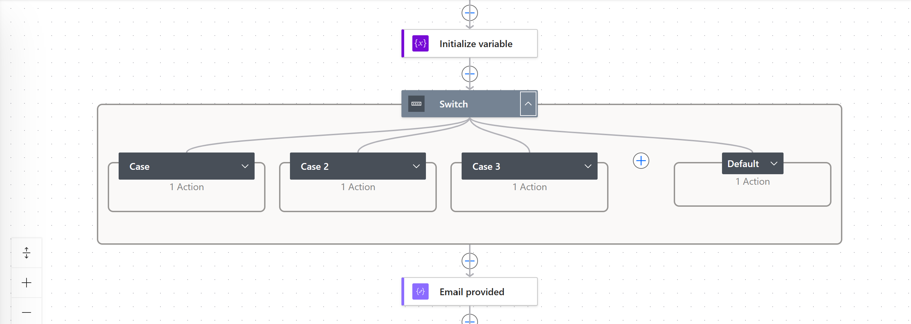
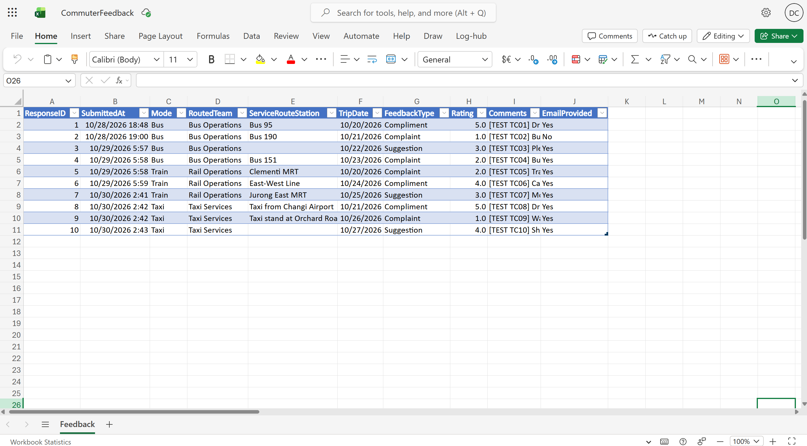
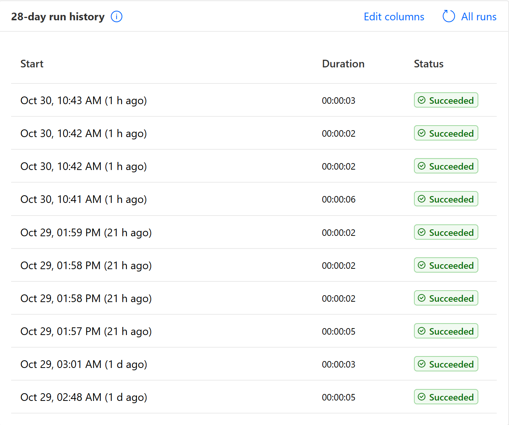

# Commuter Feedback Automation

A working demonstration of business process automation with Microsoft Power Automate. Commuter feedback is collected through Microsoft Forms, routed by transport mode, logged to an Excel table, and acknowledged by email. It's all built with standard Microsoft 365 tools and no code.

> **Demonstration project.** This is a portfolio piece, built and tested with synthetic data. It is not a production customer service system, and no feedback is sent to any real transport operator.

## Business problem

Feedback that arrives through a form often sits in an inbox and gets sorted by hand. Someone has to read each submission, decide which team it belongs to, copy it into a tracker and reply to the sender. That's slow, inconsistent and easy to forget.

This workflow automates those routine steps:

- **Sorting:** each submission is assigned to the right team automatically.
- **Record keeping:** every submission is logged to one structured table.
- **Replying:** an acknowledgement is sent when an email address is provided.

## Technologies

| Tool | Role |
|---|---|
| Microsoft Forms | Feedback form with 7 questions |
| Power Automate (automated cloud flow) | Trigger, routing, logic and orchestration |
| Excel Online (Business) in OneDrive for Business | Feedback log, in a single table called `FeedbackLog` |
| Office 365 Outlook | Acknowledgement email |

Only standard connectors are used. There are no premium connectors, custom code, external APIs or databases.

## Workflow

```
Microsoft Forms: new response
        │
        ▼
Get response details
        │
        ▼
Switch on "Mode of transport"   →  sets one RoutedTeam variable
   Bus     → Bus Operations
   Train   → Rail Operations
   Taxi    → Taxi Services
   Default → Unrouted
        │
        ▼
Compose "Email provided"        →  Yes / No
        │
        ▼
Excel: add one row to FeedbackLog (10 columns)
        │
        ▼
Condition: Email provided = Yes?
   Yes → Outlook: send acknowledgement
   No  → skip (run still succeeds)
```

## Features

- **Category routing.** A Switch maps each transport mode to a team label. A Default branch catches anything unexpected as `Unrouted`, so nothing fails silently. The team names are demonstration labels written to the table only.
- **One logging step.** Routing only sets a variable, and a single Excel action runs afterwards, so no step is repeated across branches.
- **Conditional acknowledgement.** A single Yes/No value, from one Compose step, is written to the `EmailProvided` column and is also the value the email Condition checks. The logged field and the send decision always come from the same calculation. A blank email never reaches the send step.
- **Log first, email second.** The row is written before the email is sent, so a failed email never loses a record.
- **Data minimisation.** The table records only whether an email was given, not the address itself. It doesn't claim that the email was delivered.
- **Honest acknowledgement wording.** The email confirms the response was recorded and states that it is a demo, that nothing is forwarded to an operator, and that no action will follow.

**`FeedbackLog` columns:** `ResponseID`, `SubmittedAt` (UTC), `Mode`, `RoutedTeam`, `ServiceRouteStation`, `TripDate`, `FeedbackType`, `Rating`, `Comments`, `EmailProvided`

## Test results

The project owner ran and checked these tests by hand, with 10 synthetic submissions:

| Check | Result |
|---|---|
| Power Automate runs | 10 / 10 succeeded |
| Excel rows | 10 logged, with no duplicate or blank rows |
| Routing | Bus 4, Train 3, Taxi 3, all to the correct team, none Unrouted |
| Acknowledgements | 9 sent and received, 1 correctly skipped (no email given) |
| Data types | Date/time, date and rating stored as real Excel values |

The planned split was 6 sent and 4 skipped. During the run, email addresses were entered for more cases than planned. The details, and what was and wasn't covered, are in [docs/test-results.md](docs/test-results.md).

## Reproduce it

You need a Microsoft 365 **work or school** account with Forms, Power Automate, OneDrive for Business and Outlook. The Forms trigger and the Excel (Business) connector don't support personal accounts. Allow about 1 to 2 hours.

1. **Form and workbook:** follow [docs/setup-guide.md](docs/setup-guide.md). Exact names and settings are in [docs/form-and-excel-spec.md](docs/form-and-excel-spec.md).
2. **Flow:** follow [docs/flow-build-guide.md](docs/flow-build-guide.md). It starts with a connector permission check, then walks through every action and includes troubleshooting.
3. **Test:** follow [docs/flow-test-plan.md](docs/flow-test-plan.md) using [test-data/test-cases.csv](test-data/test-cases.csv). Send acknowledgements only to your own address.

## Screenshots

These are taken from the working demo. They show the structure of the form, flow and data. Action settings such as the Switch case values, column mappings and expressions aren't visible in them. Those are documented in [docs/flow-build-guide.md](docs/flow-build-guide.md).

**1. Feedback form.** The first three questions. Note that the live form has an "Other" option on *Mode of transport* (see Limitations).



**2. Flow overview.** Trigger, Get response details, Initialize variable, Switch, Compose "Email provided", Add a row into a table, Condition.



**3. Switch routing.** Three cases plus Default, each with one action that sets the routing variable.



**4. FeedbackLog table.** The 10 test records, routed by mode. `EmailProvided` is `No` only for TC02.



**5. Run history.** Ten successful runs. Run times are shown in local time, while `SubmittedAt` in the table is UTC.



## Limitations

This is a demonstration, not a production system:

- **Scale:** it was tested with 10 synthetic submissions only. Excel isn't a database, and the connector has throttling and file-locking limits.
- **"Other" option:** the live form allows an "Other" answer on *Mode of transport*, which differs from the spec. Such a response should fall into the `Default` branch and be logged as `Unrouted`, but no test chose "Other", so that path is untested.
- **Routing:** routing is a label in a table. No team inbox, ticketing or case tracking is involved, and there's no follow-up workflow.
- **Email:** Forms can't validate email format, so a typo causes a failed run, although the row is still logged. There are no retries or alerts. Resubmitting a failed run would create a duplicate row.
- **Time:** times are stored in UTC.
- **Ownership:** the flow runs under one user's account and connections. A real deployment would need a service account, access controls and a data retention policy.
- **Reporting:** dashboards such as Power BI were deliberately left out of scope to keep the focus on process automation.

## Repository contents

| Path | Purpose |
|---|---|
| `docs/form-and-excel-spec.md` | Form questions and settings, Excel schema and routing rules |
| `docs/setup-guide.md` | Steps to create the form and workbook |
| `docs/flow-build-guide.md` | Connector check, flow build, failure handling and troubleshooting |
| `docs/flow-test-plan.md` | Planned test procedure and checks |
| `docs/test-results.md` | Actual test results and how they differ from the plan |
| `docs/screenshots/` | The five screenshots, plus capture and privacy notes |
| `test-data/test-cases.csv` | 10 synthetic test cases. Every test comment is tagged `[TEST TCxx]` |

## Status

| Item | Status |
|---|---|
| Form and Excel workbook | Done, verified by the owner |
| Power Automate flow (routing, logging, conditional email) | Done, verified by the owner |
| Testing with 10 synthetic cases | Done, verified by the owner |
| Documentation | Done |
| Screenshots | Done, captured by the owner |
| Power BI dashboard | Deliberately excluded from scope |
